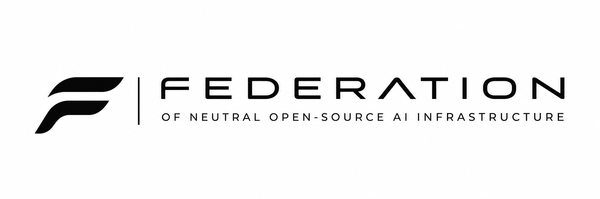

  

AI infrastructure should be common, vendor-neutral by design and independently verifiable, so that no captured or compromised system can define truth for everyone.

The federation is a shared home for independent open-source projects that build this infrastructure. Each project keeps its own code, roadmap, license and business. Only the shared work is decided together, in public.

### Repositories

| | |
|---|---|
| [agent-governance-vocabulary](https://github.com/NOSAI-Federation/agent-governance-vocabulary) | Shared terms for agent governance, and a crosswalk for each project that maps its own records onto them. |
| [Crosswalk matrix](https://nosai-federation.github.io/agent-governance-vocabulary/) | Every crosswalk against every term, rebuilt on each change. |

### How decisions are made

- [Shared principles](https://github.com/NOSAI-Federation/agent-governance-vocabulary/blob/main/PRINCIPLES.md)
- [How shared files change](https://github.com/NOSAI-Federation/agent-governance-vocabulary/blob/main/SHARED-DECISIONS.md)
- [The move to this organization on 21 November 2026](https://github.com/NOSAI-Federation/agent-governance-vocabulary/issues/244), under the plan in [#247](https://github.com/NOSAI-Federation/agent-governance-vocabulary/pull/247)

### Taking part

Participation is open, voluntary and free. Most projects start with a pull request that adds a crosswalk for their own system. Being listed or contributing does not enroll a project in shared governance, which needs the project's own explicit opt-in.
